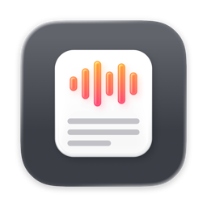
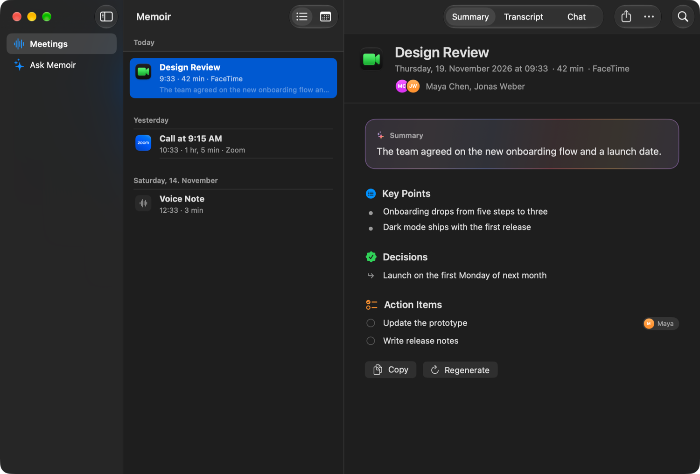
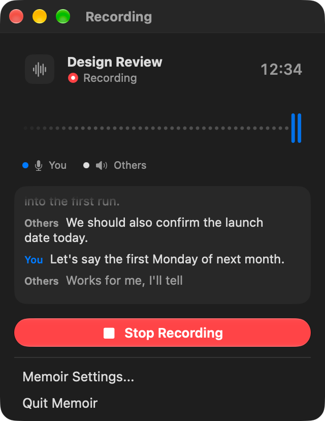
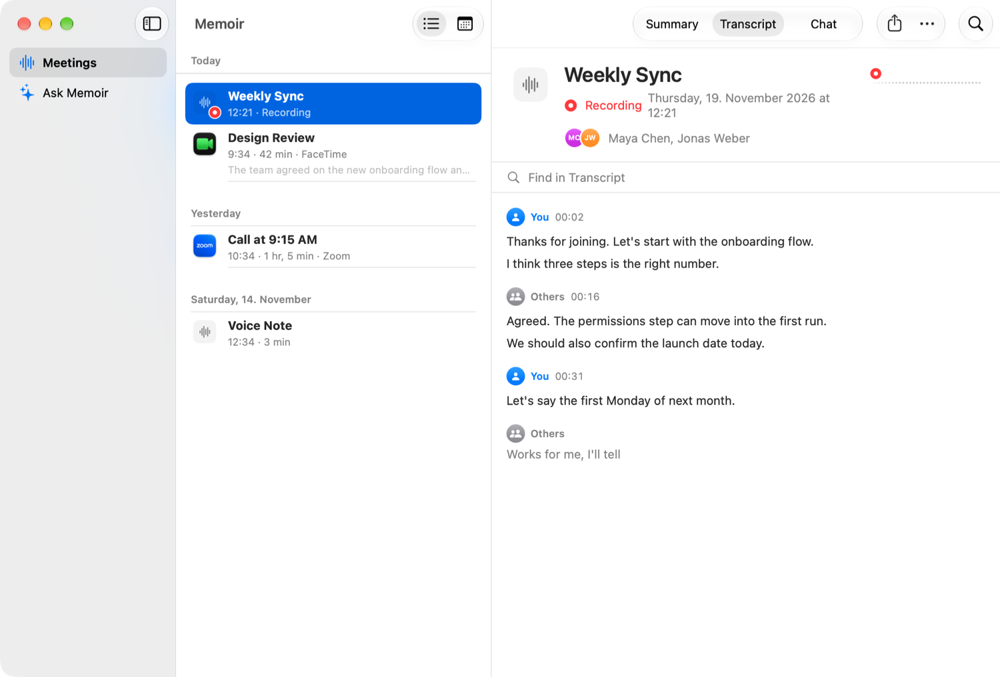
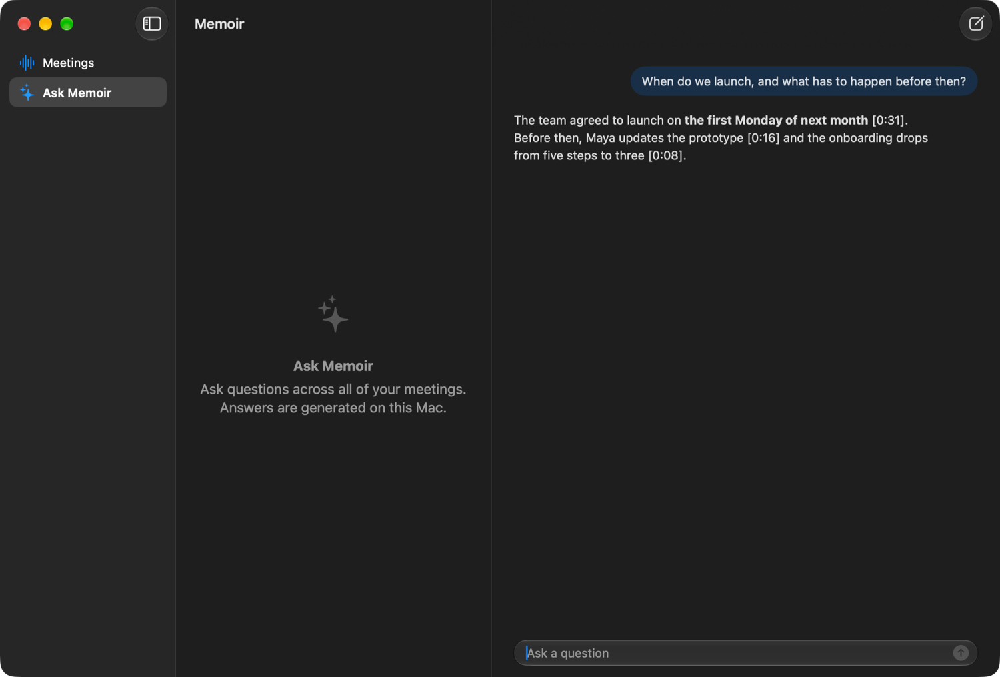

<div align="center">



# Memoir

A macOS menu bar app that records your meetings, transcribes them and writes
the notes for you. Recording, transcription, summaries and chat all run on your
Mac with Apple's on-device speech and language models.


</div>



Most meeting note tools upload your calls to a server, and taking notes by
hand means half listening. Memoir notices when a call starts and records your
microphone and the other participants separately. When the call is over you
have a transcript, a summary and the action items. There's no account, and
recordings stay in `~/Library/Application Support/Memoir`.

If you want more, Settings > Transcription offers two open models to download:
pyannote Community-1 tells the other participants apart, and Parakeet
transcribes the recording again more accurately. They run on your Mac as well.
Downloading them from Hugging Face is the only time they use the network.

## Features

### Recording



- Start and stop recordings from the menu bar. The icon shows a timer while
  one is running.
- Your microphone and the Mac's audio output are recorded separately, so the
  transcript can tell your lines from everyone else's.
- The transcript appears live in the menu bar window and in the library while
  you talk.
- The menu bar window lists your next calendar meeting with Join and Record
  buttons, and your recent recordings below it.
- Start and Stop Recording are available in Shortcuts and through Siri.

### Meeting detection

- Memoir suggests recording when a meeting app takes the microphone (Zoom,
  Teams, FaceTime, Google Meet, Webex, Slack, Discord and a dozen more, plus
  web meetings in browsers, which count once the camera is on) or when a
  calendar meeting starts. Each signal can be turned off in Settings > Detection.
- A suggestion that matches a calendar event names the recording after the
  event and lists its attendees.
- Suggestions arrive as macOS notifications, so your notification and Focus
  settings apply. Settings > Detection can show them as a tip under Memoir's
  menu bar icon instead.
- When the call app lets go of the microphone, Memoir offers to stop.
- Choose "Don't ask for this app" in a suggestion to mute an app. Muted apps
  can be unmuted in Settings.

### Library



- Every meeting has a Summary, Transcript and Chat tab.
- The summary is written when the recording ends: a title, an overview, key
  points, decisions and action items with owners, which you can tick off.
  Long meetings are condensed in parts first, since the on-device model only
  takes so much text at once.
- Click a line in the transcript to play the recording from there. You can skip
  15 seconds back or forward, play at up to 2x and search the transcript.
- Browse meetings as a list or a calendar and search titles, summaries and
  transcripts.
- Export a meeting as Markdown, reveal its folder in Finder, rename it inline
  or delete it.
- A recording without a transcript can be transcribed afterwards.
- With speaker identification on, the other side shows up as Speaker 1,
  Speaker 2 and so on. Click a name to rename that speaker for the meeting;
  summaries, chat and exports use the name too.

### Ask Memoir



- Ask about one meeting in its Chat tab, or about all of them in Ask Memoir.
  Apple Intelligence answers on your Mac.
- Answers include timestamps. In a meeting's chat, click one to hear that part
  of the recording.
- <kbd>⌘</kbd><kbd>K</kbd> in the menu bar window asks a question without
  opening the library.

### AI assistants

Claude and other assistants can search and read your meetings through an
[MCP](https://modelcontextprotocol.io) server built into Memoir. It's off by
default and read-only. Turn it on in Settings > AI Assistants, where you'll
also find the command for Claude Code and the config snippet for Claude
Desktop. More in [docs/ai-assistants.md](docs/ai-assistants.md).

Keep in mind that whatever an assistant reads goes to its provider. This is
the one part of Memoir where meeting content leaves your Mac.

## Keyboard shortcuts

| Action | Shortcut |
| --- | --- |
| Show Summary / Transcript / Chat | <kbd>⌘</kbd><kbd>1</kbd> / <kbd>2</kbd> / <kbd>3</kbd> |
| Find in the transcript | <kbd>⌘</kbd><kbd>F</kbd> |
| Next / previous match | <kbd>⌘</kbd><kbd>G</kbd> / <kbd>⇧</kbd><kbd>⌘</kbd><kbd>G</kbd> |
| Play / pause the recording | <kbd>Space</kbd> |
| Export as Markdown | <kbd>⇧</kbd><kbd>⌘</kbd><kbd>E</kbd> |
| Reveal in Finder | <kbd>⇧</kbd><kbd>⌘</kbd><kbd>R</kbd> |
| Delete meeting | <kbd>Delete</kbd> in the meeting list |
| New conversation in a chat | <kbd>⌘</kbd><kbd>K</kbd> |
| Ask Memoir (menu bar window) | <kbd>⌘</kbd><kbd>K</kbd> |
| Open the library (menu bar window) | <kbd>⌘</kbd><kbd>L</kbd> |

## Requirements

- macOS 26 or later.
- Summaries and chat need a Mac that supports Apple Intelligence, with Apple
  Intelligence turned on. Recording and transcription work without it.
- The speech model for your language. Memoir downloads it during setup, or
  later in Settings > General.

## Installation

Download `Memoir-<version>.dmg` from the
[releases](https://github.com/robertjndw/memoir/releases) and drag Memoir into
Applications.

Or install it with [Homebrew](https://brew.sh):

```sh
brew install --cask robertjndw/tap/memoir
```

Memoir updates itself, so `brew upgrade` leaves it alone unless you pass `--greedy`.
Settings > General lets you switch to the Beta channel or turn off automatic update checks.

### From source

**Requirements:** Xcode 27.

```sh
git clone https://github.com/robertjndw/memoir.git
cd memoir
./scripts/install.sh   # builds a Release copy into /Applications
```

Run `./scripts/install.sh` again to update. The installed copy is only
replaced once the build has succeeded. If Memoir is running, the script asks
before quitting it, since that would end a recording.

### Permissions

On first launch Memoir asks for the microphone, for system audio recording
(to hear the other participants) and, optionally, for your calendars.

macOS asks about system audio the first time you record, and apps can't check
what you answered. If a recording only has your side, look in System Settings >
Privacy & Security > Screen & System Audio Recording.

## How it works

The microphone goes through AVAudioEngine with Apple's voice processing turned
on, which keeps the other people's voices coming out of your speakers out of
your track. Everything else the Mac plays is recorded with a Core Audio process
tap that excludes Memoir. The two tracks stay separate while recording and are
mixed into a mono `audio.m4a` at the end, about 29 MB per hour.

Each track gets its own `SpeechAnalyzer`, which is how the transcript knows
whether a line is "You" or "Others". With speaker identification on, the system
audio track is split by voice once the recording has ended, which is where
"Speaker 1" and "Speaker 2" come from. Summaries and chat use the Foundation
Models framework. For chat, Memoir looks up the relevant transcript passages
with keyword and semantic search, and the model can call tools to search and
list meetings.

Detection looks at which processes are using the microphone, whether the
camera is on and what's in your calendar. It suggests recording at most once
per call.

Meetings are stored with SwiftData in `~/Library/Application Support/Memoir`,
and each recording gets a folder under `Recordings/`.

## Development

```sh
open Memoir.xcodeproj   # then build and run the Memoir scheme
```

Debug builds run as a separate app, "Memoir Dev". It has its own bundle id
(`de.jandow.Memoir.debug`) and settings, and keeps its data in
`~/Library/Application Support/Memoir Dev`, so it can run next to the
installed copy without touching its recordings or its MCP socket.

The project signs ad-hoc by default, so it builds without an Apple Developer
account. An ad-hoc signature changes with every build, though, and macOS then
asks for the microphone and system audio again. To sign with your own team,
copy `Config/Local.xcconfig.example` to `Config/Local.xcconfig` (gitignored)
and fill it in.

Run the tests with <kbd>⌘</kbd><kbd>U</kbd> in Xcode or from the terminal:

```sh
xcodebuild test -project Memoir.xcodeproj -scheme Memoir -destination "platform=macOS"
```

The tests are hosted in the app, but with inert services and an in-memory
store, so they don't touch your recordings or the microphone.

Most views have previews with sample meetings and canned Apple Intelligence
answers (see `Memoir/UI/Library/PreviewData.swift`). The screenshots in this
README are from those previews.

Debug builds understand two launch arguments:

- `-debugAutoRecordSeconds 15` records for that many seconds, stops and logs
  the transcript.
- `-debugOpenLibrary YES` opens the library window at launch.

### Project layout

- `Memoir/App` - the app entry point, `AppModel` (recording state, windows,
  detection) and the live and inert `Services`.
- `Memoir/Audio` - microphone capture, the system audio tap, level meters and
  the final mixdown.
- `Memoir/Transcription` - the `SpeechAnalyzer` pipeline and speech model
  downloads.
- `Memoir/Detection` - meeting detection: which apps hold the microphone,
  the camera, calendar events, meeting links and the floating suggestions.
- `Memoir/Intelligence` - summaries, chat sessions and their tools, prompts and
  the retrieval index used by chat and the MCP server.
- `Memoir/MCP` - the MCP server the app runs on a Unix socket, and its tools.
- `Memoir/Store` - the SwiftData models and where recordings live on disk.
- `Memoir/Intents` - the Start and Stop Recording App Intents.
- `Memoir/UI` - the library, menu bar window, settings and onboarding.
- `MemoirMCPBridge` - `memoir-mcp`, a small stdio to Unix socket bridge that MCP
  clients launch. It ships inside the app bundle.
- `MemoirTests` - unit tests.
- `scripts/install.sh` - builds a Release copy and installs it.
- `scripts/build-dmg.sh` - builds the DMG that releases ship, see
  [docs/releasing.md](docs/releasing.md).
- `Config` - `Info.plist` additions and the signing settings.
